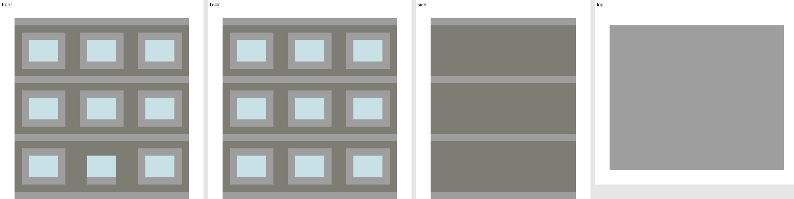

# 建筑重建 MCP + Skills

本地 Python MCP 服务与 3 个可发现 Skills。目标是从点云和参考照片得到**规整的建筑结构、受保护的门窗开口，以及保留少量杂色的材质**，最终导出 WorldEdit `.schem`。无远程模型服务依赖，原始照片和点云只读。

## 项目描述

**Building Reconstruction MCP 将现实建筑的点云与照片参考，转化为可编辑、可复现、可导入 Minecraft Java 版的建筑模型。** 项目最初用于塔楼的点云补全与方块化重建，并将其中的结构规整、对称分析和材质处理方法整理为可复用的 MCP 工具与 Skills，适用于塔楼、楼房及重复立面等场景。

重建以明确的建筑构件为中间模型：点云提供尺寸、层高和实测颜色参考，照片辅助判断结构与开口，Agent 或人工将这些证据整理为墙体、楼板、平台、梁柱、杆件及门窗参数，再生成规则的方块几何。核心要求包括：

- **结构规整**：统一构件截面、轮廓、层间关系和重复模数；对有证据支持的对称结构进行补全，并保留实测与推断来源。
- **门窗留空**：将门洞、窗位、连廊和架空层作为独立约束；空气与玻璃分别保护，避免后续补全或材质处理封住开口。
- **保留少量真实杂色**：温和估计方向光照偏差，在同类构件的相近材质族内保留部分实测明暗与色度变化，同时保持几何不变。
- **过程可复现**：保存构件规格、坐标变换、处理参数、版本与校验记录，支持修改参数后重新生成和核对结果。

**输入**为本地点云（PLY/NPZ）、可选参考照片、构件规格与方块材质表；**输出**为 WorldEdit `.schem`、体素数据、前后侧顶预览和验证报告。基本流程为：数据检查与裁剪 → 可选照片预处理和 SfM → 构件及开口建模 → 规整几何生成 → 光照估计与材质映射 → 验证与导出。

MCP 提供可调用的处理工具和异步任务接口，Skills 提供证据判断、参数选择与验收规则。当前定位是 **Agent 辅助的参数化重建工作流**；建筑构件与开口需要明确指定，任意照片的全自动建筑识别尚未实现。

## 已实现与边界

| 能力 | 实现 |
|---|---|
| 点云 | PLY/NPZ 检查、范围裁剪、Y 轴对称候选补点，保留实测/推断来源 |
| 照片 | 灰度 70% + CLAHE 30%，ROI 与过曝遮罩，原像素尺寸和原彩色文件不变 |
| SfM | 可选 PyCOLMAP CPU 特征提取、匹配、稀疏重建；失败与零模型如实报告 |
| 几何 | 明确构件规格生成 box / 旋转矩形 ring / rod，或导入已有体素 |
| 开口 | 所有实体生成后扣除门窗与通道；空气、玻璃填充分别锁定并逐格验证 |
| 材质 | 实测点近邻 RGB 中位数、构件级方向光照偏差估计、同类材质族内保留少量变化 |
| 导出 | Sponge v3 NBT、真实 VarInt、回读校验、前后侧顶四视图预览、尺寸与连通分量报告 |
| 复现 | 参数、输入 SHA256、代码 SHA256、依赖版本、原始与派生文件分开；异步任务持久化 |

需要 Agent/人工从证据中提出构件、开口和对称轴。当前没有任意照片自动识楼、自动 SfM–点云精配准、稠密重建、通用 Potree 解码、自动删碎片或自动支撑修复。碎片、支撑通过报告定位后修改构件规格并重建；不得把窗洞补实。规则模型是带推断的建筑表达，不能称为真实测绘或工程结构验证。预览按整方块均色显示，不是游戏实机渲染。

## 安装与启动

Python 3.11+。以下以 Windows 工作区 `C:/BuildingWorkspace` 为例，可替换成自己的路径。请保留克隆目录名 `reconstruction-kit`，使示例中的相对路径直接可用。

```powershell
New-Item -ItemType Directory -Force C:/BuildingWorkspace | Out-Null
cd C:/BuildingWorkspace
git clone https://github.com/reisa531/building-reconstruction-mcp.git reconstruction-kit
cd reconstruction-kit
python -m venv .venv
./.venv/Scripts/python.exe -m pip install -e '.[test,sfm]'
./.venv/Scripts/python.exe -m pytest -q
./.venv/Scripts/python.exe -m reconstruction.server --root C:/BuildingWorkspace
```

服务通过 stdio 通信，普通日志只写 stderr；不能把它当 HTTP 页面打开。`sfm` 为可选项，不使用照片重建时可省略。`requirements-lock.txt` 是本次 Windows/Python 3.12 的实际依赖版本快照；需要相同环境时先安装该文件再 `pip install --no-deps -e .`。它不是跨平台二进制保证。

Codex 接入：

```powershell
codex mcp add building-reconstruction --env PYTHONUTF8=1 -- C:/BuildingWorkspace/reconstruction-kit/.venv/Scripts/python.exe -m reconstruction.server --root C:/BuildingWorkspace
codex mcp get building-reconstruction --json
```

其他支持 stdio 的客户端使用 `mcp-config.example.json`，改为本机的绝对路径。CLI 注册方式依据 [OpenAI MCP 文档](https://developers.openai.com/codex/mcp)，SDK 使用已固定主版本的 [官方 Python SDK v1](https://github.com/modelcontextprotocol/python-sdk/tree/v1.x)。不需要 API Key。

将 `skills/` 下 3 个目录复制至自己的 `~/.codex/skills`（如设置了 CODEX_HOME，则使用其中的 skills 目录）。新会话可使用：

```text
使用 $reconstruct-building，根据本地建筑点云和照片重建 MC 建筑；结构规整，给门窗留空，温和校正光照并保留少量杂色。
使用 $preserve-building-openings 检查楼房门窗和底部架空层是否被补实。
使用 $relight-building-materials 仅调整材质，保持几何与玻璃位置不变。
```

## MCP 调用方式

先调用 `capabilities()` 和 `get_operation_schema(operation)`。然后：

```json
{
  "operation": "run_pipeline",
  "parameters": {
    "spec_path": "reconstruction-kit/examples/building-structure.json",
    "palette_path": "reconstruction-kit/examples/building-palette.json",
    "data_version": 5023
  }
}
```

调用 `start_job` 得到 job_id，通过 `get_job(job_id)` 等到 completed / failed / interrupted。completed 表示工具执行成功，COLMAP 的 `result.status:no_model` 仍表示重建没有成功。输出保存至 root 下 `reconstruction-runs/<job_id>/`，包含 job.json、job.log 和派生产物。工具自身不会选择或覆盖历史建筑包。

路径必须位于服务 `--root` 下，支持相对路径或 root 内绝对路径，拒绝越界与符号链接逃逸。服务没有任意命令执行工具。将新数据放进授权工作区，或用另一个 `--root` 启动服务。

| operation | parameters |
|---|---|
| crop_cloud | source, bounds_min/max（三维源坐标） |
| symmetry_cloud | source, center=[cx,cz], angle_degrees, min_height, voxel_size（输入须 Y 向上） |
| preprocess_photos | entries=[{source, polygon 可选像素多边形}]；输出 photos/images、photos/masks |
| attempt_colmap | images 目录、masks 可选目录（同图名加 .png）；每图独立 SIMPLE_RADIAL 相机，CPU |
| build_geometry | spec 对象或 spec_path 二选一 |
| import_voxels | source NPZ（positions/palette_index/component_id/dims） |
| map_materials | geometry, cloud, palette 或 palette_path, transform 4×4, policy 可选 |
| validate_build | geometry |
| export_schem | geometry, palette 或 palette_path, data_version 正整数 |
| preview_build | geometry, palette 或 palette_path |
| run_pipeline | spec / spec_path / geometry_source 三选一；palette / palette_path 二选一；data_version；可选 cloud + transform + policy |

`inspect_cloud(source)` 为只读即时检查；很大的点云可能耗时，应先裁剪到建筑级数据。PLY 属性 x/y/z，RGB 属性 red/green/blue，可选 provenance、donor_index；NPZ 为 xyz、rgb、provenance。缺少 RGB 时颜色映射全部回退基础材质，不能把灰色占位值冒充实测。当前读取整份 PLY/NPZ，完整校园应先通过既有提取工具做节点级裁剪。

发现接口还有 `read_report(path)`、`list_jobs()`，资源 `reconstruction://capabilities`、`reconstruction://operation/{operation}`、`reconstruction://job/{job_id}`，以及 `reconstruct_building` prompt。

## 几何、开口与材质规格

详细规则见 [模型约定](skills/reconstruct-building/references/model.md)、[开口规则](skills/reconstruct-building/references/openings.md)、[材质规则](skills/reconstruct-building/references/materials.md) 和 [完整流程](skills/reconstruct-building/references/workflow.md)。

构件规定形状与截面，openings 作为必须保留的负空间，避免先从点云逐点体素化再用无约束补洞。所有构件写入后最后扣洞；玻璃 `fill_palette>0` 锁定，空气 `fill_palette=0` 严禁占据。坐标均为 MCXYZ / Y 向上，整数范围左闭右开，体素中心为 pos+.5。

材质默认值：

```json
{
  "nearest_distance": 4,
  "k": 16,
  "min_samples": 80,
  "angular_strength": 0.5,
  "max_log_gain": 0.18,
  "brightness_retention": 0.25,
  "chroma_retention": 0.15,
  "brightness_limits": [0.85, 1.15],
  "allowed_by_component": {"1": [1, 3]}
}
```

每类构件分别鲁棒拟合 log RGB 数值亮度的方向项与高度项，只温和去掉方向偏差。25% 和 15% 是保留的残差强度，并不是杂色方块占比。量化在限定的相近材质族中进行；不随机喷色、不改形状、不烘焙新阴影、不添加发光块。它不能区分所有阴影、真实风化与材质差异，不是物理反照率恢复。

## 示例和复跑

在交付包目录执行：

```powershell
./.venv/Scripts/python.exe -m reconstruction.cli --root C:/BuildingWorkspace --params examples/building-pipeline.json
./.venv/Scripts/python.exe -m reconstruction.cli --root C:/BuildingWorkspace --params examples/tower-replay.json
./.venv/Scripts/python.exe -m reconstruction.cli --root C:/BuildingWorkspace --params examples/tower-structure-pipeline.json
```

- 楼房示例从完整构件规格生成：28×26×24，17 个玻璃窗和 1 个门洞。可独立修改层数、窗格、墙厚和材质。
- tower-replay 导入现有四边形平台塔几何再重新映射实测颜色：42×192×54，19,228 块；保留历史几何，采用更少杂色的新默认材质策略。
- tower-structure 从显式平台与交叉杆件规格重新生成近似塔：四边形平台 0°/45° 交替，13,828 块；不等同于历史模型。

首次运行可直接使用仓库内的示例 JSON，无需执行生成脚本。`examples/make_examples.py` 可重建示例 JSON。楼房示例不需要当前塔数据；塔 replay 需要项目既有几何、实测点云与 palette，包中没有再次复制大型点云。DataVersion 5023 是当前塔历史 Java 26.3 目标值，其他版本需重新核对，不代表永久“最新正式版”。

`.schem` 用 WorldEdit `//schem load <文件名>` 后按需要粘贴。空气洞口要在已有实体上真正挖空时，不能使用跳过空气的 `//paste -a`；建议在空地或独立测试世界导入。回读校验仅验证文件布局与 ID 编码；实际游戏效果、透明块连接、通行和照明需在游戏中验证。

## 验证与交付

测试运行 `python -m pytest -q`，证据摘要见 `verification.json`。交付包含源代码、Skills、示例参数与安装配置。标准运行生成可审计的 job.json、pipeline.json、NPZ、`.schem`、preview.png。中断任务重启后标记 interrupted，不伪报完成。没有跨重启续跑或取消正在执行的 CPU 任务功能；需要时重开新任务。

## 示例预览



图中展示前后侧顶视图。该示例由构件参数生成；源码仓库不包含原始校园点云或参考照片。塔 replay 的本地资产引用仅作为原项目复现说明；新用户可直接运行楼房与参数化塔示例。
